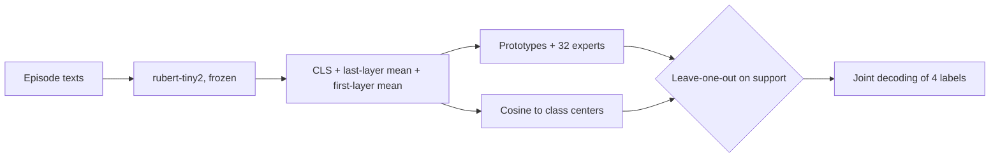
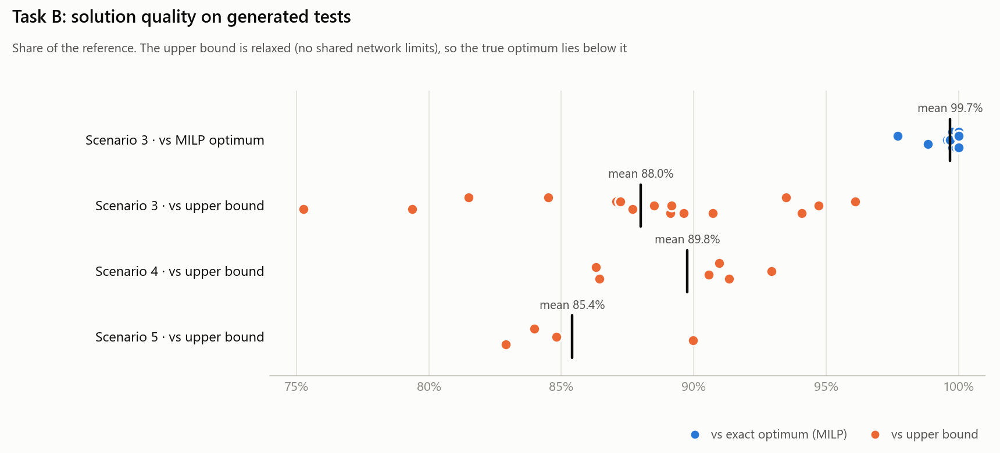

# Yandex ML Test Assignment

[Русская версия](README.md)

Solutions to the two tasks of an ML test assignment. Task A is few-shot classification under a hidden rule, task B is planning model rollouts to devices. Final result: **192.33 out of 200 points**.

October 2026. The task statements and the organizers' starter code are not included. Short summaries are below.

## Task A. Few-shot classification under a hidden rule

**Task.** Each episode has 8 labeled messages (four labeled 0 and four labeled 1) and 4 unlabeled ones. Every episode follows its own binary rule, and the model has to infer it from meaning and label the 4 messages. An episode counts only if all 4 labels are correct (Episode Exact Match). Constraints:
- the [`cointegrated/rubert-tiny2`](https://huggingface.co/cointegrated/rubert-tiny2) encoder is frozen;
- at most 150,000 trainable parameters;
- CPU only, two threads;
- training and prediction together fit into 25 minutes.

**Solution** (`a-few-shot-rules/solution/`):
- **Features** (`features.py`): the frozen encoder gives the CLS vector and the token mean of the last layer, plus the token mean of the first layer, 3 × 312 = 936 in total. Texts are deduplicated and sorted by length to keep batches dense.
- **Head** (`model.py`, 140,580 parameters) sits on an MLP encoder (936 → 128 → 128) and adds up two signals:
  - class prototypes: the distance from the query to the mean of positive and negative examples;
  - 32 "experts": linear projections. The episode shows how well each one separates the classes, and softmax routing picks the informative directions.

  A separate cosine classifier runs on the raw features.
- **Per-episode head selection:** leave-one-out over the 8 support examples. The head that makes fewer mistakes there is used.
- **Joint decoding of the 4 labels.** All 16 label assignments are scored. The likelihood is combined with a prior over the number of positives estimated on train, so the decoding optimizes exact match directly rather than each label separately.
- **Training** (`train.py`): episodes are re-split every epoch (a fresh 4 + 4 support set from the same episode). Then AdamW with OneCycleLR, at least 40 epochs, the loss is the sum of BCE for both heads, and the seed is fixed.



**How to run.** The files go into `starter/solution/` of the official starter kit. Its `data.py` and `runtime/` are required but not included here.

```bash
python -m starter.solution.train --train train.jsonl --adapter runs/adapter.safetensors
python -m starter.solution.predict --data eval.jsonl --adapter runs/adapter.safetensors --output predictions.jsonl
```

## Task B. Model rollout planning

**Task.** There are T days, S devices in H households and U model updates of C types. Each update has a type, a size, a release day and a "value". Constraints:
- the server's daily traffic and each household's daily internet are limited;
- every device has a limit on the number of updates;
- a new model replaces the old one of the same type.

The goal is a rollout schedule that maximizes the total weighted value over all days. There are six scenarios, from a single device up to 100,000 devices and 10,000 updates.

**Solution** (`b-rollout-planning/`):
- **Scenarios 1–5** (`solutions/scenario_1.py` … `scenario_5.py`):
  1. Dominated updates are dropped: released later while giving less value or weighing more.
  2. A lazy greedy algorithm on a heap. The value of a device–update pair is recomputed only after the plan has changed. For each pair it finds the earliest day where both the household and the server have capacity.
  3. Local search until the time limit. A random group of devices (1–3 households, or the devices of one day) is cleared and rebuilt greedily with random weights. A worse result is rolled back.
- **Scenario 6** (`solutions/scenario_6.py`, 100,000 devices): a separate scalable algorithm.
  - The update size is penalized with a Lagrange multiplier λ, tuned on a 1% sample of devices.
  - For every class and weight, tables of the best one- and two-step update "ladders" are precomputed.
  - Devices are grouped, and the schedule respects the server limit.
- **Tools** (`tools/`):
  - a scenario test generator;
  - a checker that validates every constraint and computes the score;
  - brute force for tiny tests;
  - an exact MILP solver (`scipy.optimize.milp`);
  - a relaxation-based upper bound.
- **Experiments** (`research/exp.py`): a local search variant with annealing and noisy weights, used to test ideas.

### Run results

Tests were generated with `tools/gen_scen.py` under the constraints of scenarios 3–6 (several seeds, with and without a value trend). Each solution ran with its own time limit.

<picture>
  <source media="(prefers-color-scheme: dark)" srcset="docs/b_quality_en_dark.png">
  
</picture>

| Scenario | Test size | Time | Result |
|---|---|---|---|
| 3 | 8 devices, 30 updates, 14 days | 1.1 s | 99.7% of the MILP optimum on average over 16 tests. The worst test is 97.7%, and 5 tests hit the optimum exactly |
| 4 | 50 devices, 100 updates, 30 days | 2.1 s | 89.8% of the upper bound (6 tests) |
| 5 | 1,000 devices, 500 updates, 90 days | 5.1 s | 85.4% of the upper bound (4 tests) |
| 6 | 100,000 devices, 10,000 updates, 365 days | 8.2 s | Fits the 20 s limit. Neither the optimum nor the bound can be computed in reasonable time at this size |

The upper bound sits well above the true optimum. On scenario 3, where the optimum is known exactly, the solution reaches 88% of the bound but 99.7% of the optimum.

**How to run.** Python 3.10+ is required. `tools/exact.py` also needs NumPy and SciPy (`pip install -r b-rollout-planning/requirements.txt`).

```bash
cd b-rollout-planning
python tools/gen_scen.py 3 1 0 > test.txt                 # scenario, seed, trend
python tools/evaluate.py solutions/scenario_3.py - test.txt
python tools/exact.py test.txt 60                         # MILP optimum for small tests
python tools/upper.py test.txt                            # upper bound
```

## Tech stack

Python, PyTorch, Hugging Face Transformers, safetensors (task A). NumPy and SciPy (MILP in task B).

## Layout

```
a-few-shot-rules/solution/   task A solution
b-rollout-planning/
  solutions/                 per-scenario solutions
  research/                  experimental version
  tools/                     generator, checker, brute force, MILP, upper bound
  tests/                     small tests
docs/                        charts for the README
```

## License

[MIT](LICENSE)

---

<sub>The code was written in October 2026 and published on GitHub in November 2026. Commit dates follow the dates of the original files; the README and figures were added at publication.</sub>
