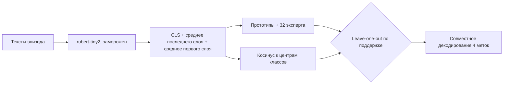
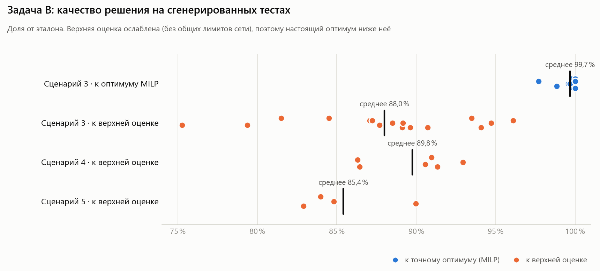

# Тестовое задание Яндекса по ML

[English version](README.en.md)

Решения двух задач тестового на направление ML. Задача A: few-shot классификация по скрытому правилу. Задача B: планирование выкатки моделей на устройства. Итог тестового: **192,33 балла из 200**.

Октябрь 2026. Условия задач и стартовый код организаторов в репозиторий не входят, ниже их краткий пересказ.

## Задача A. Few-shot классификация по скрытому правилу

**Условие.** Каждый эпизод содержит 8 размеченных сообщений (4 с меткой 0 и 4 с меткой 1) и 4 сообщения без меток. В каждом эпизоде действует своё бинарное правило: его нужно уловить по смыслу и разметить 4 сообщения. Эпизод засчитывается, только если верны все 4 метки (Episode Exact Match). Ограничения:
- энкодер [`cointegrated/rubert-tiny2`](https://huggingface.co/cointegrated/rubert-tiny2) заморожен;
- не больше 150 000 обучаемых параметров;
- только CPU и два потока;
- обучение и предсказание вместе укладываются в 25 минут.

**Решение** (`a-few-shot-rules/solution/`):
- **Признаки** (`features.py`): из замороженного энкодера берутся CLS и среднее по токенам последнего слоя плюс среднее по первому слою, всего 3 × 312 = 936. Тексты дедуплицируются и сортируются по длине, чтобы батчи получались плотнее.
- **Голова** (`model.py`, 140 580 параметров) построена на MLP-энкодере 936 → 128 → 128 и складывает два сигнала:
  - прототипы классов: расстояние запроса до среднего положительных и отрицательных примеров;
  - 32 «эксперта»: линейные проекции, для каждой эпизод показывает, насколько хорошо она разделяет классы, а softmax-маршрутизация выбирает информативные направления.

  Отдельно работает косинусный классификатор по сырым признакам.
- **Выбор головы в эпизоде:** leave-one-out по 8 примерам поддержки. Используется та голова, которая на них ошибается меньше.
- **Совместное декодирование 4 меток.** Перебираются все 16 вариантов разметки. К правдоподобию добавляется априорное распределение числа единиц, оценённое на train. Так оптимизируется именно exact match, а не каждая метка по отдельности.
- **Обучение** (`train.py`): на каждой эпохе эпизоды пересобираются (новые 4 + 4 примера поддержки из того же эпизода). Дальше AdamW и OneCycleLR, не меньше 40 эпох, лосс складывается из BCE обеих голов, seed фиксирован.



**Запуск.** Файлы кладутся в `starter/solution/` официального стартового пакета: `data.py` и `runtime/` из него нужны, но сюда не входят.

```bash
python -m starter.solution.train --train train.jsonl --adapter runs/adapter.safetensors
python -m starter.solution.predict --data eval.jsonl --adapter runs/adapter.safetensors --output predictions.jsonl
```

## Задача B. Планирование выкатки моделей

**Условие.** Есть T дней, S устройств в H домах и U обновлений моделей C типов. У каждого обновления свой тип, размер, дата релиза и «полезность». Ограничения:
- каждый день ограничены раздача сервера и интернет каждого дома;
- у устройства есть лимит на число обновлений;
- новая модель заменяет старую того же типа.

Нужно составить расписание выкатки, которое даёт максимум суммарной взвешенной полезности за все дни. Сценариев шесть: от одного устройства до 100 000 устройств и 10 000 обновлений.

**Решение** (`b-rollout-planning/`):
- **Сценарии 1–5** (`solutions/scenario_1.py` … `scenario_5.py`):
  1. Отбрасываются доминируемые обновления: вышли позже, а полезности дают меньше или весят больше.
  2. Ленивый жадный алгоритм на куче. Ценность пары «устройство–обновление» пересчитывается, только когда план изменился. Для каждой пары ищется самый ранний день, где хватает лимитов дома и сервера.
  3. Локальный поиск до лимита времени. Случайная группа устройств (1–3 дома или устройства одного дня) очищается и собирается заново жадным алгоритмом со случайными весами. Если стало хуже, изменения откатываются.
- **Сценарий 6** (`solutions/scenario_6.py`, 100 000 устройств): отдельный масштабируемый алгоритм.
  - Размер обновления штрафуется множителем Лагранжа λ, который подбирается на выборке из 1 % устройств.
  - Для каждого класса и веса заранее считаются таблицы лучших одно- и двухшаговых «лестниц» обновлений.
  - Устройства группируются, и расписание строится с учётом лимита сервера.
- **Инструменты** (`tools/`):
  - генератор тестов по сценариям;
  - чекер: проверяет все ограничения и считает счёт;
  - полный перебор для крошечных тестов;
  - точное решение через MILP (`scipy.optimize.milp`);
  - верхняя оценка через релаксацию.
- **Эксперименты** (`research/exp.py`): версия локального поиска с отжигом и шумом в весах для проверки идей.

### Прогон

Тесты сгенерированы `tools/gen_scen.py` по ограничениям сценариев 3–6 (разные seed, с трендом полезности и без). Каждое решение запускалось со своим лимитом времени.

<picture>
  <source media="(prefers-color-scheme: dark)" srcset="docs/b_quality_ru_dark.png">
  
</picture>

| Сценарий | Размер теста | Время | Результат |
|---|---|---|---|
| 3 | 8 устройств, 30 обновлений, 14 дней | 1,1 с | 99,7 % от оптимума MILP в среднем по 16 тестам. Худший тест 97,7 %, в 5 тестах ровно оптимум |
| 4 | 50 устройств, 100 обновлений, 30 дней | 2,1 с | 89,8 % от верхней оценки (6 тестов) |
| 5 | 1 000 устройств, 500 обновлений, 90 дней | 5,1 с | 85,4 % от верхней оценки (4 теста) |
| 6 | 100 000 устройств, 10 000 обновлений, 365 дней | 8,2 с | Укладывается в лимит 20 с. Оптимум и оценка на таком размере за разумное время не считаются |

Верхняя оценка заметно выше настоящего оптимума. На сценарии 3, где оптимум известен точно, решение набирает от неё 88 %, хотя от оптимума 99,7 %.

**Запуск.** Нужен Python 3.10+. Для `tools/exact.py` ещё понадобятся NumPy и SciPy (`pip install -r b-rollout-planning/requirements.txt`).

```bash
cd b-rollout-planning
python tools/gen_scen.py 3 1 0 > test.txt                 # сценарий, seed, тренд
python tools/evaluate.py solutions/scenario_3.py - test.txt
python tools/exact.py test.txt 60                         # оптимум MILP для небольших тестов
python tools/upper.py test.txt                            # верхняя оценка
```

## Стек

Python, PyTorch, Hugging Face Transformers, safetensors (задача A). NumPy и SciPy (MILP в задаче B).

## Структура

```
a-few-shot-rules/solution/   решение задачи A
b-rollout-planning/
  solutions/                 решения по сценариям
  research/                  экспериментальная версия
  tools/                     генератор, чекер, перебор, MILP, верхняя оценка
  tests/                     небольшие тесты
docs/                        графики для README
```

## Лицензия

[MIT](LICENSE)

---

<sub>Код написан в октябре 2026, на GitHub выложен в ноябре 2026. Даты коммитов взяты по датам исходных файлов, README и иллюстрации добавлены при выгрузке.</sub>
